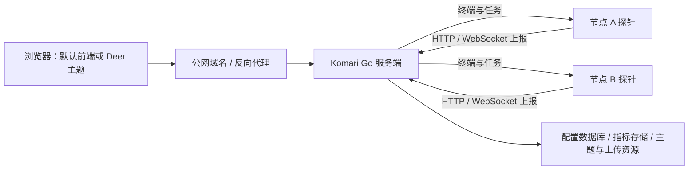
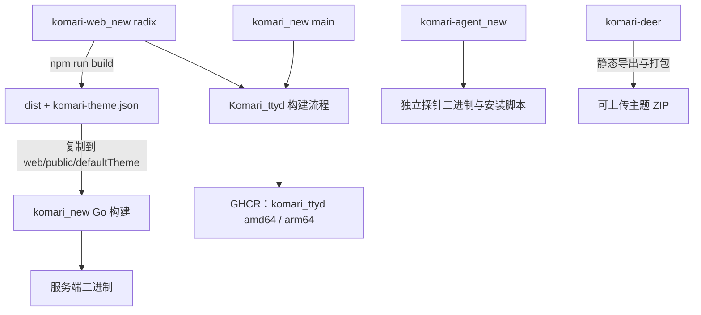

# Komari 工作区总览

这个目录汇集五个独立 Git 仓库：服务端、默认前端、探针、Docker 集成和 Deer 主题。
`/home/zv/github/komari/` 本身是本机工作区容器，没有独立 `.git`；各子仓库分别提交、
推送和发布。目录名中的 `_new` 是现有 Fork 的正式名称。

本文记录仓库职责、运行关系和修改入口。单仓库部署与开发细节请进入对应 README。
核对日期：2026-11-06。

本机总览的远端副本保存在 [`Komari_ttyd/docs/workspace-overview.md`](./Komari_ttyd/docs/workspace-overview.md)，
随 Docker 集成仓库提交；本目录不会新增包含子仓库的父级 Git 仓库。

## 目录与职责

```text
komari/
├── README.md                         # 工作区总入口（本文件）
├── komari_new/                       # Go 服务端
├── komari-web_new/                   # React/Vite 默认前端与管理后台
├── komari-agent_new/                 # Go 探针
├── Komari_ttyd/                      # Docker 集成与镜像发布
├── komari-deer/                      # Next.js 静态导出的可选主题
│   ├── public/komari-appearance.js   # 独立背景运行时
│   └── docs/APPEARANCE-SCRIPT-SPEC.md
├── build-20261101/                    # 上游维护的本机构建产物和验收记录
├── build-20261102-enter/              # 回车提交维护的构建与浏览器验收记录
└── build-20261102-nat64/              # NAT64 与可见 IP 信任验收记录
```

| 仓库 | 当前维护分支 | 职责 | 主要文档 |
| --- | --- | --- | --- |
| [komari_new](https://github.com/zv201413/komari_new) | `main` | 登录与权限、配置、节点、指标、通知、主题管理、终端转发和 API | [README](./komari_new/README.md)、[安装说明](./komari_new/install.md)、[增强特性](./komari_new/docs/features.md) |
| [komari-web_new](https://github.com/zv201413/komari-web_new) | `radix` | 默认监控页面、完整管理后台、节点编辑、登录与 2FA 交互、主题设置 UI | [开发与主题打包](./komari-web_new/README.md) |
| [komari-agent_new](https://github.com/zv201413/komari-agent_new) | `main` | 被监控机器上的采集、上报、网络探测与远程任务执行；包含安装和更新脚本 | [README](./komari-agent_new/README.md) |
| [Komari_ttyd](https://github.com/zv201413/Komari_ttyd) | `main` | 将服务端与默认前端打包为镜像，集成 Nginx、Supervisor、ttyd、可选 Cloudflare Tunnel | [部署说明](./Komari_ttyd/README.md)、[高级指南](./Komari_ttyd/ADVANCED_GUIDE.md) |
| [komari-deer](https://github.com/zv201413/komari-deer) | `main` | 基于 `tonyliuzj/komari-next` 的独立主题；紧凑卡片、列表、地球与背景显示 | [中文 README](./komari-deer/README-CN.md)、[背景脚本规格](./komari-deer/docs/APPEARANCE-SCRIPT-SPEC.md) |

后端、默认前端、探针分别配置了 `komari-monitor` 官方仓库的 `upstream`。
Docker 和 Deer 当前只配置本 Fork 的 `origin`。Deer 的原始项目来源已在其 README 和许可证中保留。

## 运行架构

核心部署是一个 Komari 服务端加若干探针。前端构建成静态资源，由服务端提供网页，
浏览器通过同站点的 HTTP / WebSocket / RPC2 API 获取数据。生产环境无需另起 Vite
或 Next.js 服务；Deer 作为主题包上传到服务端后，也由同一个服务端提供。



服务端的主要入口：

| 路径 | 负责内容 |
| --- | --- |
| `komari_new/web/router/` | HTTP 路由；普通 JSON 接口桥接到 RPC2，部分敏感接口保留专用处理 |
| `komari_new/web/rpc/jsonrpc/` | 公共、管理员和探针 RPC 方法 |
| `komari_new/web/api/` | 登录、2FA、主题上传、节点信任等接口 |
| `komari_new/database/`、`internal/config/` | 账号、会话、节点和业务配置的持久化 |
| `komari_new/internal/server/` | 服务初始化、运行与指标存储对接 |
| `komari_new/web/agent/`、`web/api/terminal/` | 在线探针、来源 IP、报告缓存与终端转发 |
| `komari_new/web/public/` | 嵌入默认前端，提供上传主题的静态资源与页面 |

### Docker 集成层

`Komari_ttyd` 使用 Supervisor 管理进程。默认公网入口是 Nginx 的 **80 端口**，
再转发到 Komari 的 **25774 端口**。启用 Tunnel 时由 cloudflared 接入；ttyd 按
`TTYD_P0` 等配置启动附加终端。

持久卷挂到 `/app/data`，服务端工作目录为 `/app`。端口、登录初始化、真实 IP 还原和
Tunnel 设置以 [Docker 部署说明](./Komari_ttyd/README.md) 为准。部署该镜像时，
平台应将面板流量送到 80 端口，以使 Nginx 的真实来源 IP 还原规则生效。

Komari 的节点终端通过服务端转发到探针；镜像中的 ttyd 是附加容器终端。两者有不同
连接与鉴权路径，具体配置分别见服务端与 Docker 文档。

## 构建与发布关系



默认前端通过 Go `embed` 编进服务端。只修改 `komari-web_new` 源码不会改变已经运行的
服务端；需要构建前端并重新发布服务端或集成镜像。上传主题走服务端的主题管理，
主题文件位于运行数据目录下的 `theme/`，可以独立更新。

后端 CI 的 [build-frontend action](./komari_new/.github/actions/build-frontend/action.yml)
默认拉取本 Fork 前端的 `radix`。Docker 的
[docker-build workflow](./Komari_ttyd/.github/workflows/docker-build.yml) 自行拉取并构建
前端与后端，默认分别为 `radix` 和 `main`；手动发布可填 `frontend_ref`、`backend_ref`
固定提交，填 `version` 后同时发布指定标签和 `latest`。镜像标签记录两端的源码 SHA，
用于核对实际构建版本。Docker 纯文档推送不触发重建。

Deer 不参与当前默认服务端或 Docker 的内嵌前端构建。它使用 Next.js 的静态导出模式，
主题包中包含 `dist/`、`komari-theme.json` 等资源。默认前端的管理功能和 Deer 的展示
功能分别在各自仓库维护，不能依靠修改其中一份自动更新另一份。

## IPv6-only 节点与第三方 DNS64/NAT64

默认前端的单节点安装、自动发现安装，以及 Deer 的安装命令，均默认勾选
“第三方 DNS64/NAT64 兼容”。使用 [nat64.net](https://nat64.net/) 的
`2a00:1098:2c::1`，生成 `--fallback-dns 2a00:1098:2c::1`：先尝试系统 DNS 和直接连接，
解析超时、解析失败或所有地址连接失败后才尝试备用 DNS64，帮助只有 IPv6 出口的
节点连接只有 IPv4 入口的面板。取消勾选即可关闭；这是新安装命令的选项，不会自动改动现有探针。

Linux/macOS 安装命令还携带 `--install-dns64`：直接下载失败时用 DNS64/NAT64
回退下载 GitHub 发布包，需 Python 3.8+。关闭时生成 `--install-dns64 off`。
安装脚本只在新内核下载并可执行后替换旧安装；不修改 `/etc/resolv.conf`，不降低 HTTPS/WSS 证书验证。
新版探针也将旧命令的 `--custom-dns 2a00:1098:2c::1` 作为系统 DNS 优先的备用路径；
其他自定义 DNS 保持优先使用，查询或连接失败后回退系统 DNS。

Unix 安装参数末尾支持 `rep`（覆盖安装）、`del`（卸载）和 `status`（查看状态）。
后两者不走下载流程；自定义目录和服务名须保留原参数。详见 [探针安装说明](./komari-agent_new/README.md)。
Windows 安装命令支持探针运行时 DNS64，发布包下载仍由 PowerShell 的原网络路径处理。

公共 NAT64 服务可能看到访问域名、连接时间和流量大小，并影响可用性；保持 HTTPS/WSS
且未启用 `--ignore-unsafe-cert` 时，中转不解密 Token、终端命令或回显。Komari 面板仍是
终端信任边界，root 探针打开的终端具有 root 权限，终端验证应保持开启。

后台将节点上报的 IP 与面板观察到的“连接来源”分别显示；不同地址标为“中转出口”，
提示可能经过 NAT64 或代理。节点“信任 IP”只对**列表可见且与在线连接来源一致**的公网 IP 生效。
未显示的中转出口不获得隐式白名单；不一致时不能新增信任，旧开关暂停免登录验证码待遇，
仍可关闭。手动白名单维持显式授权，账号密码和终端验证规则保持原义。
详见 [节点 IP 信任](./komari_new/docs/node-ip-trust.md) 和 [探针安装说明](./komari-agent_new/README.md)。

## 按需求找修改位置

| 要修改的内容 | 主要仓库 | 需要同时核对 |
| --- | --- | --- |
| 登录、2FA、白名单、节点 IP 信任、终端授权 | `komari_new` + `komari-web_new` | API 校验、管理 UI、登录接口；Docker 部署要发布新镜像 |
| 节点字段、监控数据、网络与系统信息 | `komari-agent_new` + `komari_new` | 协议兼容、存储与展示；显示字段还涉及默认前端或 Deer |
| 默认 UI、管理后台、默认主题背景 | `komari-web_new` | 后端主题配置与重新嵌入构建 |
| Deer 卡片、地球、列表、独立背景脚本 | `komari-deer` | 主题 API、配置键和主题 ZIP；背景行为与默认前端保持约定一致 |
| 镜像、入口脚本、端口、真实 IP、Tunnel、ttyd | `Komari_ttyd` | 拉取的前后端提交、持久卷和发布标签 |
| 跨仓库架构与导航 | 本目录 `README.md` | 各仓库仍各自维护具体文档 |

## 登录 IP 信任与节点删除

节点行里的“信任 IP”是节点自己的动态授权。登录时核对总阀门、节点选择、在线状态、
服务端观察到的公网来源 IP 和当前探针令牌；不会向账号的手动白名单复制一条记录。
**删除节点会自动撤销该节点提供的信任并清除其来源 IP 缓存。**

若同一 IP 还有另一台在线受信任节点，或账号手动白名单也添加了该 IP，其他授权仍会
生效。账号密码仍须验证，已经登录的会话也需通过会话管理单独注销。
实现与接口验收见 [节点删除与登录 IP 信任](./komari_new/docs/node-ip-trust.md)。

## 文档归属与维护记录

主题背景的 `APPEARANCE-SCRIPT-SPEC.md` 已归入
[komari-deer/docs/](./komari-deer/docs/APPEARANCE-SCRIPT-SPEC.md)，与独立脚本一起受该
仓库的版本管理，并从 Deer README 链接。它描述可复用的主题脚本约定；默认主题的
React 实现仍位于 `komari-web_new/src/components/AppearanceRuntime.tsx`。

`build-20261101/` 是本机留存的那轮构建、测试截图、日志和交付记录，不是源码仓库或
运行数据目录。上游取舍的长期文档以
[2026-11-01 评估报告](./komari_new/docs/upstream-review-2026-11-01.md) 为准：本轮采用
兼容修复回移，没有整体迁移到官方 1.6.1。该轮已发布
`ghcr.io/zv201413/komari_ttyd:maintenance-20261101-node-trust`，历史回执见
[final-delivery.json](./build-20261101/final-delivery.json)；`latest` 是滚动标签。

本目录 README 是本机总导航；维护时同步到 `Komari_ttyd/docs/workspace-overview.md`，随该仓库推送。
后续组件文档放进对应仓库的 `docs/` 或 README，构建产物留在按日期命名的本机目录，
总入口只维护架构、归属和链接。

2026-11-02 的保存与确认回车交互约定见
[回车保存与确认](./komari-web_new/docs/keyboard-submit.md)，验证记录见
[build-20261102-enter/verification.json](./build-20261102-enter/verification.json)。
保存与确认交互、DNS64/NAT64 及可见 IP 信任修复已完成本机构建和浏览器验收，随本轮维护提交到各组件仓库。线上是否生效需按实际服务端／镜像版本确认。
NAT64 验收记录保存在本机 `build-20261102-nat64/`。
